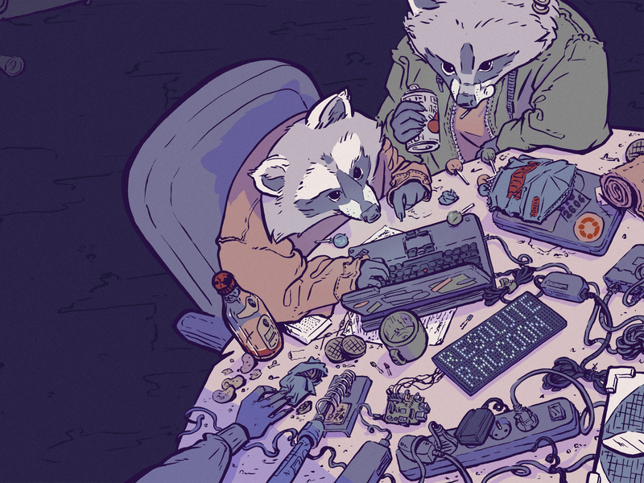

<h1 align="center">
  
</h1>

  

  

  

---

## 🕹️ Player Status

- 🎓 **Level:** 6th-semester Computer Science student.
- ☕ **Main Focus:** Java & Spring Boot backend development.
- 📜 **Core Knowledge:** Strong foundation in C language and computer science fundamentals.
- 🗄️ **Database:** SQL query optimization and UML modeling.
- 🐧 **Environment:** Linux (Ubuntu) for daily development.
- 🎮 **Interests:** Video games, software architecture, and technology.

---

## 🛠️ Tech Inventory

  

---

## 📊 Guild Stats (GitHub Stats)

  
  

---

  

